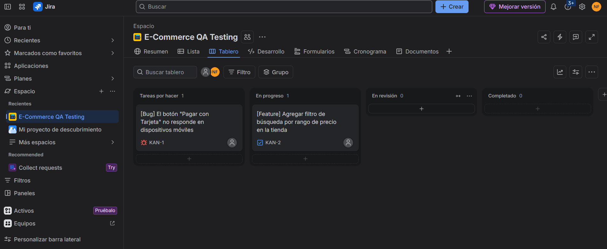

# e-commerce-qa-portfolio
Documentación de pruebas QA, reporte de bugs e historias de usuario en Jira para un sistema E-commerce.
# E-Commerce QA Testing & Bug Tracking

Este proyecto documenta el proceso de control de calidad (QA) y gestión de incidencias para una plataforma de E-commerce utilizando **Jira Software** bajo metodología Kanban.

## Captura del Tablero de Trabajo

## Ejemplos de Documentación de Incidencias

### 1. Reporte de Error Crítico [KAN-1]
* **Tipo:** Bug / Escarabajo
* **Resumen:** [Bug] El botón "Pagar con Tarjeta" no responde en dispositivos móviles
* **Prioridad:** Alta / Crítica
* **Pasos para reproducir:**
  1. Ingresar a la tienda desde un navegador móvil (Safari / Chrome en iOS/Android).
  2. Agregar un producto al carrito de compras.
  3. Ir a la pantalla de Checkout y seleccionar "Pago con Tarjeta".
  4. Hacer clic en el botón "Finalizar Compra".
* **Resultado Esperado:** El usuario debe ser redirigido a la pasarela de pagos.
* **Resultado Actual:** El botón no realiza ninguna acción (Error 500 en consola).

---

### 2. Historia de Usuario [KAN-2]
* **Tipo:** Feature / Story
* **Resumen:** [Feature] Agregar filtro de búsqueda por rango de precio en la tienda
* **Estado:** En progreso
* **Criterios de Aceptación:**
  - Control deslizable / campos numéricos para precio mínimo y máximo.
  - Actualización dinámica del catálogo al aplicar el filtro.

---
**Herramientas utilizadas:** Jira Software, Metodología Agile/Kanban, QA Testing.
